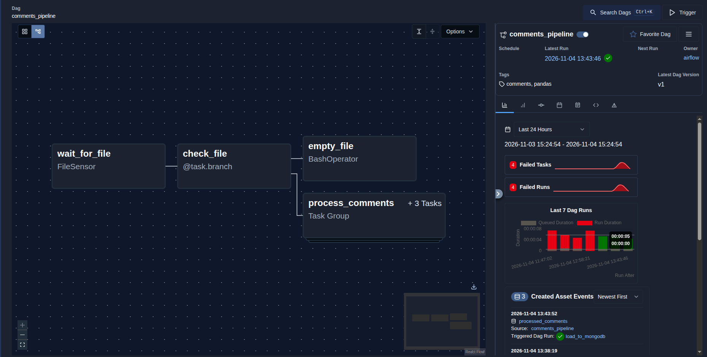
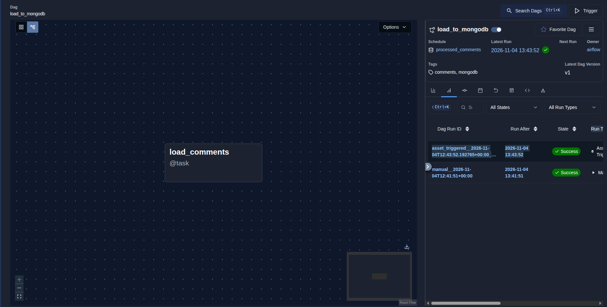

# Airflow & MongoDB Data Pipeline

## Project Description

This project demonstrates a local data processing pipeline built with Apache Airflow, Python, Pandas, and MongoDB.

The pipeline processes comment data from a CSV file, performs data transformations, and loads the processed records into MongoDB using Airflow Asset-based scheduling.

## Technologies

- **Apache Airflow 3.1.5** — workflow orchestration and scheduling.
- **Python 3.12** — programming language for data processing.
- **Pandas** — CSV data manipulation and transformation.
- **MongoDB 8.2.7** — NoSQL database for storing processed data.
- **PyMongo** — Python library for interacting with MongoDB.
- **Docker & Docker Compose** — local environment deployment.
- **PostgreSQL** — Airflow metadata database.

## Project Structure

```text
airflow-mongodb-project/
├── config/
├── dags/
│   ├── comments_pipeline.py
│   └── load_to_mongodb.py
├── data/
│   ├── comments.csv
│   ├── step1.csv
│   ├── step2.csv
│   └── processed_comments.csv
├── logs/
├── mongodb/
│   └── aggregations.js
├── plugins/
├── .env
├── screenshots/
│   ├── omments_pipeline.png
│   └── load_to_mongodb.png
├── docker-compose.yaml
├── Dockerfile
├── requirements.txt
└── README.md
```

## Pipeline Architecture

The project consists of two DAGs.

### 1. `comments_pipeline`

This DAG is responsible for processing the input CSV file.

**Workflow:**

1. **FileSensor** — waits for the input CSV file to appear in the specified directory.
2. **BranchPythonOperator (`@task.branch`)** — checks whether the file is empty.
3. **Empty file branch** — executes a BashOperator that logs a message if the file is empty.
4. **Data processing branch** — processes the file using a TaskGroup.

The TaskGroup contains three sequential tasks:

- **replace_nulls** — replaces missing values with `-`.
- **sort_by_date** — sorts records by `created_date` in ascending order.
- **clean_content** — removes emojis and unnecessary characters from the `content` column while preserving text and punctuation.

After all transformations are completed, the final CSV file is saved as `processed_comments.csv`.

The last task updates the `processed_comments` Asset.

### 2. `load_to_mongodb`

This DAG loads the processed data into MongoDB.

It uses Asset-based scheduling:

- The DAG is triggered automatically when the `processed_comments` Asset is updated.
- The processed CSV file is read using Pandas.
- The records are converted into dictionaries.
- The data is inserted into the `comments` collection in the `comments_db` database.

The collection is cleared before inserting new records to prevent duplicates during repeated loads.

## MongoDB Aggregation Queries

Three aggregation queries are implemented in `mongodb/aggregations.js`.

1. **Top 5 frequently occurring comments** — groups comments by content, counts occurrences, sorts them in descending order, and returns the top five.
2. **Comments shorter than 5 characters** — filters documents based on the length of the `content` field.
3. **Average rating per day** — converts `created_date` strings into BSON Date values, groups records by day, and calculates the average rating.

## Screenshots

### Comments Processing DAG



### MongoDB Loading DAG



## Local Environment Setup

### Prerequisites

- Docker
- Docker Compose
- Git